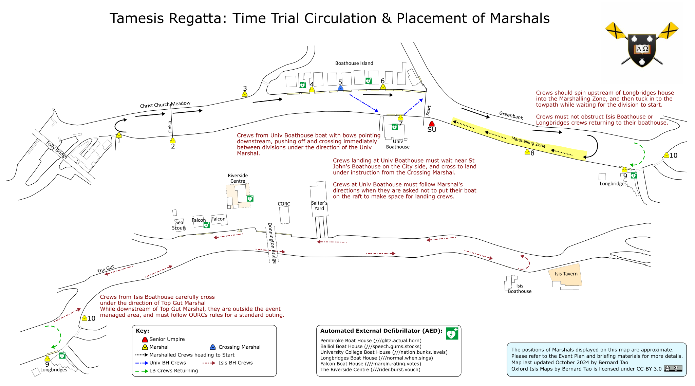
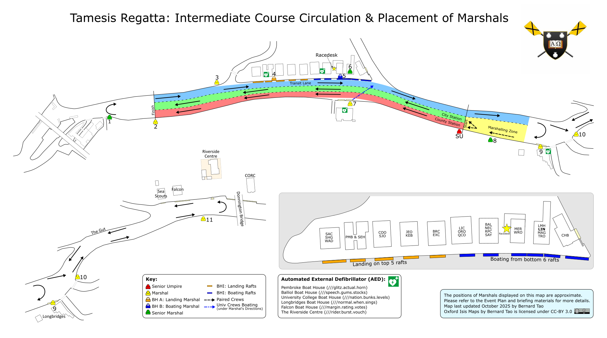
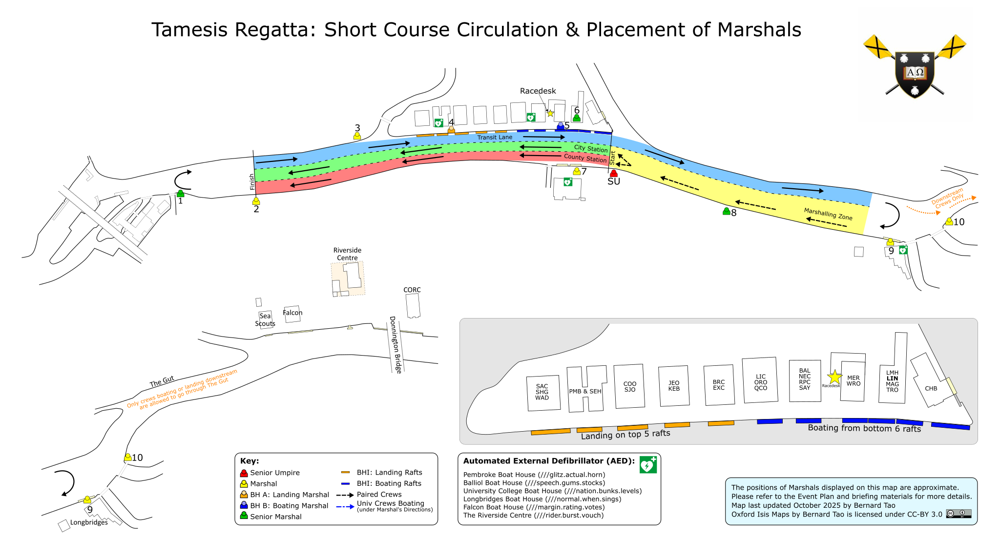

# Tamesis Regatta {{ dates.year }}: Event & Safety Plan

**Linacre Boat Club**

**Version {{ event_plan.version }}**, {{ event_plan.date | ukdate }}

Prepared by {{ event_plan.prepared_by }}

### Changelog

| Version | Date | Notes |
| :--- | :--- | :--- |
| 2026.0 | 2026-07-19 | 2025 plan converted to website format, with dates and officials updated for 2026 |
| 2026.1 | 2026-10-14 | <ul><li>Add provision for limited racing on Low Amber Flag under strict safety controls</li><li>Make contingencies for missed racing flexible, with example scenarios</li><li>Run time trials on the short course only</li><li>Standardise wording to racing finishing half an hour before sunset each day</li><li>Add this changelog</li></ul> |

## Opening Remarks { .tr-new-page }

The Tamesis Regatta is run from {{ daterange(dates.regatta_start, dates.regatta_end) }} (the traditional dates of Wednesday to Saturday of 7th week). Racing will be scheduled to take place from 12 pm on Wednesday to Friday, and from 11 am on Saturday, until half an hour before sunset each day. The course is from a start on the Greenbank to the finish near the Cox Stone. As with all water-based events, safety is the regatta's primary concern.

Conducting a safe Novice Regatta presents far fewer problems than an event such as Summer Eights or Torpids. There are fewer crews racing at any one time, the style of racing is different (i.e. side-by-side racing instead of “bumps” racing) and the course is much shorter. This document provides a comprehensive safety plan for the event, concerning the participants and organisers.

The event committee consists of senior rowers and coxes from Linacre Boat Club and support from further members with over a decade of regatta management experience.

This Plan should be read in conjunction with OURCs Code of Conduct, the OURCs Rules of Racing, and British Rowing’s RowSafe.

 

## Definitions

 

| Term | Meaning |
| :---- | :---- |
| **Race Desk** | Racing is coordinated by the Event Organisers from Merton Small Boats bay. The Event Secretary, and Chief Marshal will be based at Race Desk. |
| **County side / County Station / Towpath side / Towpath Station** | These terms are interchangeable, and refer to the side of the river closest to the Towpath. Longbridges Boathouse and University College Boathouse can be considered to be on the County side of the River. |
| **City side / City Station** | These terms are interchangeable, and refers to the side of the river closest to Christ Church Meadow / Boathouse Island. For side-by-side racing, the City Station is the central buoyed lane, with the transit lane on the City side of the river. |
| **Transit Lane / Navigation Lane** | These terms are interchangeable. For side-by-side racing there will be 3 lanes marked by buoys. The lane on the City side of the river will be used for most river traffic heading downstream. |

## Regatta Organisation

The Regatta Organisers are responsible for all aspects of risk assessment and safety plan implementation for Tamesis Regatta. They are as follows:

**{{ roles.regatta_captains.title }}:** {{ roles.regatta_captains.name }}

*May also be referred to as the Race/Event Secretary, and on the radio using the Race Desk callsign*

**{{ roles.senior_umpires.title }}:** {{ roles.senior_umpires.name }}

*The Senior Umpire may also be referred to as the Start Marshal*

**{{ roles.chief_marshal.title }}:** {{ roles.chief_marshal.name }}

**{{ roles.captain_of_coxes.title }}:** {{ roles.captain_of_coxes.name }}

**{{ roles.water_safety_advisor.title }}:** {{ roles.water_safety_advisor.name }}

**{{ roles.post_incident_coordinator.title }}:** {{ roles.post_incident_coordinator.name }}

The duties of the “Safety Advisor” as defined in the BR Rules of Racing are contained within the duties of the Water Safety Advisor for the event.

They will be equipped with a two-way radio to contact marshals and other important personnel, and they will each have a mobile telephone for emergency use at all times during racing.  The safety adviser will be present at the river throughout the event. The Water Safety Advisor present will also act as Incident Controller for purposes of the Emergency Action Plan.

Contact details for the Regatta Organisers and other key contacts are in Appendix 4. The Race Committee may make alterations to the event plan at their discretion and all decisions are final. 

A Risk Assessment has been conducted, and is included as Appendix 6 to this document. 

## Safety Awareness

 

**Swim Tests**

All **competitors (including coxswains) must have passed an OURCs swim test** before being allowed to compete. Competitors who have failed to pass a swimming test will not be allowed to compete (the wearing of a personal flotation device (PFD) will not be accepted in lieu of a swim test: this is above and beyond guidance in the BR water safety code “RowSafe”). 

**Coxswains** 

It is **compulsory for all coxswains to attend the Coxes’ Regatta safety briefing** which will be held in conjunction with OURCs. The date is to be confirmed, but it is planned to be the Wednesday of Week 6 of Michaelmas Term ({{ dates.coxing_briefing | ukdate }}). In cases of illness or academic clashes, exemptions may be given by the Regatta Captain of Coxes in consultation with OURCs. Exemptions have to be requested via email no later than 11am on the day the briefing will take place. However, exemptions, if at all, can only be given to coxes who are X or S status. Coxes who have been exempted from attending the briefing are required to review the relevant information, especially the circulation pattern, which will be made available on the regatta web page and circulated to all boat clubs via email. **ALL coxswains are required to wear a PFD, in line with the [OURCs Code of Conduct](https://ourcs.co.uk/organisation/conduct/).**

**Medical cover** 

A **Medical Unit** will be present at all times during racing. There shall be **a medical post at the Race Desk and the medical launch, with an assigned medic, at all times** (see [Launches](#launches)). The Unit shall consist of at least two people dedicated to medical cover at the event and **qualified in line with the medical providers’ risk assessment.** 

The medical team shall be informed, through their agents, of the nature of the event, and will have the risk assessment made available to them. Furthermore, they will be required to hold liability insurance of their own or through their employer, and will be issued a copy of the schedule.

The medical unit this year will be provided by Epione Medical Services.

**Launches**
{ #launches }

Three launches are available for the event: the medical launch and two safety launches. A launch is **providing cover** when it is afloat, with a qualified driver and a radio, ready to respond.

* **Medical launch:** dedicated to medical cover, with an assigned medic, at all times during racing. It has access to all parts of the course and complete priority over any racing crews. It is stationed wherever the medics prefer; in recent years this has been at Race Desk. Racing is suspended while the medical launch is unavailable.
* **Safety launches:** the two safety launches are interchangeable. When not needed for cover, a safety launch may transport marshals, such as those stationed on the County side, and additional medical personnel as required. If the medical launch breaks down, a safety launch may replace it.

How many safety launches must be providing cover depends on conditions:

* **Normal racing:** at least one.
* **Intermediate course, with crews allowed through the Gut** (see [Transit through the Gut](#gut-transit)): both, with one stationed near Longbridges to assist crews below it quickly. If only one safety launch is available, crews will not be allowed through the Gut.
* **Low Amber Flag** (see [Racing on Low Amber Flag](#racing-on-low-amber-flag)): both, with at least one stationed downstream of all marshalling crews. If either is unavailable, racing on Low Amber Flag is suspended.

**Emergency Access**

In case of an emergency, the **emergency services, in particular the ambulance service, shall be made aware of the regatta and all access points.** In the event of a 999 call, emergency service access is possible from:

1. **Riverside Centre off Donnington Bridge** (postcode OX4 4AZ, ///copy.bath.ridge)  
2. **University College Boathouse via Abingdon Road** (postcode OX1 4PS, ///nation.bunks.levels)  
3. **Boat House Island via ChCh Meadow** (///scrap.wiring.mixed). Call ChCh Lodge {{ phone('chch_lodge') }} for access  
4. **Longbridges Boat House** (key to gate off Donnington Bridge (///causes.gets.scars) held at Race Desk)

**In case of an accident around or below the Gut, any casualties should be transported to** Riverside Centre {{ phone('riverside_centre') }} **to allow them to be reached by an ambulance.** 

In case they need to be contacted, the phone number for **City of Oxford Rowing Club** is **{{ phone('city_of_oxford_rc') }}**

## Marshals

Maps detailing the placement of marshals can be found in Appendix 3.

Marshalls will be drawn from experienced rowers and coxes; Linacre Boat Club will provide experienced marshals for critical positions such as at position 9 (pairing marshal), 6 (tower marshal), and 7 (Univ marshal). The remaining balance to be provided by the clubs participating, with each club providing one experienced marshal per entry, in a similar manner to bumps racing. 

### Briefing

All marshals will attend a pre-regatta marshalling briefing, which will be held before the regatta. This year the marshal briefing will be held at Linacre College on {{ dates.marshal_briefing | ukdate }}. This pre-regatta briefing will cover the marshalling duties in detail.

On the race day itself, a second briefing of key points will be held at Race Desk to refresh the marshals on the key aspects of their role, and will include a mock river check, radio checks, and before racing starts - klaxon testing. 

The klaxon test serves two purposes:

1.       Ensure all marshals know how to use their klaxon

2.       That all of the issued klaxons are working

After briefing marshals shall head to their stations.

Those stationed on the County side of the river may be able to be transported on a safety launch.

### Coordination

During racing, there will be a Chief Marshal assigned by the Regatta Organisers, who will have a mobile phone for emergency use.

The contact details of the Chief Marshal will be provided to all marshals during their on-the-day briefing.

Marshalling will be split into 2 shifts on each race day, and the first shift of marshals will remain at their posts until relieved by the second shift marshal.

The Chief Marshal shall assign more experienced marshals to cover the most critical positions, such as the Head and Univ. The positions highlighted in bold in the list of marshals should be filled by marshals deemed by the event committee to have sufficient experience.

### Equipment

Marshals will be provided with:

* High visibility bib
* Two-way radio
* Clipboard, with a summary of duties for their assigned role, race schedule, a list of blade colours to aid in crew identification, and emergency contact numbers.

Marshals will be required to provide:

* Their own private mobile phone, and share the number with the Event Committee before their shift

Some marshals, identified below, will additionally be provided with:

* Klaxon
* Megaphone
* Flag
* Stopwatch / Timer

### River Checks

The Senior Umpire, or their assistant will conduct river checks with marshals, to ascertain whether it is safe to conduct racing, and the location of any river traffic.

These will proceed in order (as listed below) from the Head of the river, working downstream.

These will usually occur during long pauses in rowing, and at the beginning of each marshalling shift, at the discretion of the Senior Umpire. Marshals conducting a river check must look particularly for non-racing river traffic, obstructions on the course, or large objects floating in the river which may create a hazard.

### General Duties

Marshals’ primary role will be to facilitate the safe running of the event. They will have radio contact with Race Desk to report emergency situations or safety situations.

Marshals are the method by which the Senior Umpire can ascertain whether the river is clear of obstructions before a race is started, and while racing is underway. This is done by the use of river checks, as detailed above, and by Marshals advising the Senior Umpire of any new river traffic / obstructions by radio on an ad-hoc basis.

If safety dictates, marshals can immediately halt racing by the sounding of klaxons. Reasons for sounding klaxons include any person falling into the water, blockage of the course, and imminent accidents.                                                                                                   

Marshals will also be instructed to pay attention to the safety of the public in addition to their other tasks.

Marshals may be requested to facilitate communication with the Regatta Organisers via their two-way radios. If using a marshal’s radio impedes them from ensuring the safety of competitors and the public at large, this will be denied.

### Raft Marshals Additional Duties

Marshals stationed by the boathouses; Boathouses A & B, Univ, and Longbridges marshals; shall undertake the following additional duties:

* Conduct equipment checks for every boat that crews are using.
* Check the identities of the rowers and coxes of crews when requested by the Chief Marshal or Event Secretary.

Where possible, the raft marshals shall track which crews have boated from the rafts which they are monitoring.

#### Equipment Checks

Checks will pay special attention to the following, in accordance with OURCs equipment rules, RowSafe, and the general practice at Torpids and Eights:

* Heel restraints: heels firmly secured and don’t rise above the lowest fixed point of the shoe.
* Bow ball is firmly attached, not just taped
* All backstays are in place
* All hatch covers are in place if the boat has watertight compartments fitted
* Coxswain wears a PFD, in line with the [OURCs Code of Conduct](https://ourcs.co.uk/organisation/conduct/)
* Switched-on 360° static white lights at front and rear at times applicable

Crews whose equipment does not meet the above criteria will not be allowed to push off.

Crews at Isis Boathouse must pre-arrange with the event organisers to schedule equipment checks. A marshal will not be stationed throughout the event at the Isis Boathouse.

#### Identity Checks

Coxes shall be required to be in possession of identification for all crewmembers while they are on the water. Such identification must contain a picture of the person being identified. A photocopy of a University card or coxing licence will be sufficient.

Crews who fail an identity check will not be allowed to push off, or if the check takes place after racing, may be disqualified.

### Time Trials

If the time trial format is chosen as a race for the repêchage or otherwise needed due to a loss of racing time due to weather or river conditions, there will be timers stationed at the start and finish.

These timers act as race observers, and record the time each crew passes their position.

Time trials always run on the short course, from the start below University College Boathouse to the finish near the Cox Stone.

The Gut Marshal shall send crews towards the Senior Umpire when it is clear, in the correct order. They may ask river traffic to tuck in at Holding Point B if necessary, or require racing crews to give way and wait.

### Positions, Equipment, and specific duties

Key:

* :material-bullhorn: Marshal is provided with a loudhailer
* :material-alarm-light:{ .tr-icon-red } Marshal is provided with a Klaxon
* :material-flag:{ .tr-icon-red } Marshal is provided with a Flag
* :material-timer-outline: Marshal is provided with a Stopwatch / Timer for the time trial racing format
* :material-check-circle:{ .tr-icon-green } Marshal participates in River Checks. Racing must stop if the posts of  marshals participating in River Checks become vacant.

 

| Equipment | Position | Specific Duties |
| :---- | :---- | :---- |
|  | **Chief Marshal** | Responsible for running marshalling briefings and assigning marshalling positions on race days and being on hand to answer any question or assist in marshalling-related matters. |
| :material-bullhorn::material-flag:{ .tr-icon-red } | **Senior Umpire (Start Marshal)** | Decides the stagger according to stream conditions on the day and gives the starting commands (“Attention\! Go\!”). They will also award a row-over to crews whose opponents are late without good reason. May disqualify any crews who start before the command is given. Conducts river check when required, or asks their assistant to do so. Location of the SU and their assistant is dependent on the racing format, and is shown on the maps in Appendix 3. |
| :material-alarm-light:{ .tr-icon-red }:material-timer-outline: | Senior Umpire’s Assistant Start Timer | **[side by side racing]** Responsible for listening to all radio traffic, alerts Senior Umpire about urgent or important situations. Conducts river checks on the Senior Umpire’s request.  **[time trials]** Notes the time each crew crosses the start line, below University College Boathouse. |
| :material-alarm-light:{ .tr-icon-red }:material-check-circle:{ .tr-icon-green }:material-bullhorn: | (1) Head | Located at the Head of the river. Liaises with other river users, asking them to move to Holding Point A and await the end the race in progress. Instructs crews who have finished to spin and return to the boathouses (via transit lane). Will note coxing protest and relay to the race desk. |
| :material-alarm-light:{ .tr-icon-red }:material-check-circle:{ .tr-icon-green }:material-bullhorn::material-timer-outline: | (2) Finish Marshal | Determines who has won the race and sounds the finishing clacker when the bow of the winning boat passes the finishing line. Also ensures that crews are well clear of the finishing line before spinning. Will note coxing protests and relay results to race desk. This position will preferably be filled by a member of the race committee to ensure consistency. |
| :material-timer-outline: | (2A) Finish Timer | *Used in Time Trials only.* Provides backup finish timing along with the finish marshal.  |
| :material-alarm-light:{ .tr-icon-red } | (3) Meadow | Stationed on the City Side between the humpback bridge, and the Finish Marshal. Advises crews moving away from the spinning area to land. Monitors the upstream end of the river is clear for racing. |
| :material-alarm-light:{ .tr-icon-red }:material-check-circle:{ .tr-icon-green } | (4) Boathouses A | See Raft Marshals (above) Stationed at the upstream half of Boathouse Island |
| :material-alarm-light:{ .tr-icon-red }:material-check-circle:{ .tr-icon-green } | (5) Boathouses B | See Raft Marshals (above) Stationed at the downstream half of Boathouse Island **[time trials]** Also acts as Crossing Marshal: crews landing at Univ wait near St John's Boathouse, and cross to land under this marshal's instruction. |
| :material-alarm-light:{ .tr-icon-red }:material-check-circle:{ .tr-icon-green } | **(6) Tower** | Stationed on the roof of one of the boathouses. This marshal is to monitor racing for safety and fairness and shall liaise with the race committee regarding any appeals. This position will preferably be filled by a member of the race committee to ensure consistency. |
| :material-alarm-light:{ .tr-icon-red }:material-check-circle:{ .tr-icon-green }:material-bullhorn: | (7) Univ | See Raft Marshals (above) Stationed at University College Boathouse. This position will preferably be filled by a member of the race committee to ensure consistency. **[side by side racing]** Coordinates with Tower Marshal to hold crews that want to boat from Univ and sends them up in transit once the current race has gone past, but with sufficient distance (in case the boat racing on County station catches a crab or runs into other boat-stopping trouble). **[time trials]** Sends Univ crews to push off and cross to the City side between divisions, and keeps the raft clear for landing crews. |
| :material-alarm-light:{ .tr-icon-red }:material-check-circle:{ .tr-icon-green } | (8) Greenbanks | Stationed below the start on the County side of the river. **[side by side racing]** Assisting crews to pair up before the start, ensuring crews are on the correct side (city/county). Advising crews in transit for landing at Univ, holding them back if race is in progress. **[time trials]** Keeps crews in the Marshalling Zone tucked in to the towpath bank, in the correct order. |
| :material-alarm-light:{ .tr-icon-red }:material-check-circle:{ .tr-icon-green }:material-bullhorn: | (9) Longbridges | See Raft Marshals (above).  Stationed at Longbridges Boathouse During time trials, liaises with river traffic to show them Holding Point B, and advises when they can proceed upstream.  During side by side racing, advises crews in transit for landing at University College boathouse. Directs crews landing at Longbridges, and may instruct a crew to land with bows pointing downstream (see [Landing at Longbridges](#longbridges-landing)). This position will preferably be filled by a member of the race committee to ensure consistency. |
| :material-alarm-light:{ .tr-icon-red }:material-check-circle:{ .tr-icon-green }:material-bullhorn: | **(10) Gut** | **[side by side racing]** Stationed at Top Gut, just below Longbridges. They are responsible for liaising with other river users, asking them to hold at Holding Point B and await the end of the race in progress.  **[time trials]** To send crews towards the start when it is clear, in the correct order. Ask river traffic to tuck in at Holding Point B if necessary.  They are responsible for liaising with other river users, asking them to hold and await the end of the race in progress. Instructs crews where to spin. Ensures that crews are moving to the start in good time and are at the correct stations to ensure that no collisions occur. Responsible for holding any crews coming upstream through the gut until it is safe to cross into race circulation above the gut. |
| :material-alarm-light:{ .tr-icon-red }:material-check-circle:{ .tr-icon-green }:material-bullhorn: | (11) Donnington Bridge | Only in use when using an intermediate course; responsible for ensuring crews do not go below Donnington Bridge (unless landing at a boathouse below it). See [Transit through the Gut](#gut-transit). |
| :material-alarm-light:{ .tr-icon-red } | Launch Driver (Medical Launch) | Launch drivers must hold RYA Powerboat L2 or equivalent qualification. Drives the [medical launch](#launches), with a member of the medical team. Transports medics to emergency sites. |
| :material-alarm-light:{ .tr-icon-red } | Launch Driver (Safety Launch) | Launch drivers must hold RYA Powerboat L2 or equivalent qualification. Drives a [safety launch](#launches), providing cover where required. Transports marshals, and additional medical personnel as required for emergency response. |

**Lights**

All crews must have switched-on white lights at the front and rear of their boats visible through 360 degrees at all times applicable, to ensure that they will be seen if the weather suddenly changes and visibility is impaired. Failure to use lights will result in disqualification. Racing will finish half an hour before sunset, to ensure that all crews leave the water before sunset. In case of a delay in racing, some races might be postponed until the next day.

**Scheduling**

Racing will take place approximately every three to four minutes, and crews are required to follow the schedule closely, otherwise appropriate action will be taken by the Regatta organisers.  Alterations to the published draw will have to be rare and on an ‘if possible’ basis; crews will be required to submit their clashes with their entry and then usually expected to abide by the draw given.

## Circulation

The issue of circulation will be heavily emphasised at both the coxswains briefing and the marshal briefing, in order to ensure that the circulation patterns are obeyed. Similar circulation patterns have worked in previous years, and we see no reason to doubt that they would continue to work safely. 

The circulation patterns both for side-by-side racing and time trials are included in the appendices to this document. The transit lane stays on the City side of the river along the whole course, so it does not cross the racing lanes. Coxswains shall be instructed to follow marshals’ commands.

Where needed for safety, instructions from the Senior Umpires or the Race Committee override the circulation rules in this plan: for example, when racing is stopped early and crews must return to their boathouses quickly (see [Emergency procedure](#emergency-procedure)).

Crews have a general responsibility, whilst sticking to circulation, to avoid other river traffic (which should in theory follow the circulation pattern under instruction from marshals) and to avoid wildlife, especially swans.

Note that the region of the river under event management is as follows:

* From Head of the River to Donnington Bridge (if using the standard intermediate-length course)  
* From Head of the River to Top Gut (if the course is shortened)

On parts of the river not under event management, OURCs clubs must abide by all standard OURCs rules for general outings.

### Transit through the Gut { #gut-transit }

* Crews boating from or landing at a boathouse downstream of the Gut, such as the Isis Boathouse, may always go through the Gut, under the direction of the Gut Marshal, except when racing on Low Amber Flag (see [Racing on Low Amber Flag](#racing-on-low-amber-flag)).
* On the short course, which all time trials use, no other crew may go through the Gut.
* On the intermediate course, the Senior Umpires and Race Committee may also allow other crews through the Gut, as far as Donnington Bridge, provided both safety launches are providing cover (see [Launches](#launches)). Whether they do will be made clear to all crews before each day's racing; if it is not allowed, no other crew may go through the Gut.

### Landing at Longbridges { #longbridges-landing }

* Crews landing at Longbridges spin and land with bows pointing upstream. In high stream, crews may spin upstream of the raft and drift back to land, still with bows pointing upstream.
* The Longbridges Marshal (9) may instead instruct a crew to land with bows pointing downstream, for example to keep the raft running efficiently.

### Time Trial

For time trials, crews may not do laps on the water to warm up. Crews proceed downstream on the City side and, under marshal instructions, spin to bowside upstream of Longbridges House into the Marshalling Zone, keeping clear of the Gut and weir streams. They then line up bow to stern, tucked in to the towpath bank and facing upstream, while waiting for their division to start. Crews in the Marshalling Zone must not obstruct crews returning to Longbridges or the Isis Boathouse.

#### Boating:

Boathouse Island crews should boat with bow-balls pointing downstream and proceed down the City side to the spinning area upstream of Longbridges House.

Crews boating from Longbridges should boat with bows facing upstream.

Crews boating from Univ boat with bows pointing downstream, pushing off and crossing immediately to the City side between divisions, under the direction of the Univ Marshal. Crews at Univ must follow the Univ Marshal's directions if asked not to put their boat on the raft, to make space for landing crews.

Crews boating from the Isis Boathouse will proceed upstream following standard (training) circulation, but must wait for instruction from the Gut Marshal before crossing to reverse circulation above the Gut.

Crews should pay particular attention to the direction of the marshals who will facilitate marshalling in the correct order.

**Crews will be started by the Senior Umpire at the start line, and marshalling crews must move up towards the Senior Umpire as each crew is set off.** 

#### Racing crews:

The racing line is considered to be as close to the towpath bank as possible. A slower crew must move to give way to a faster crew by steering towards the middle of the river. Impeding a faster crew may incur a time penalty at the discretion of the Senior Umpire.

After crossing the finish line, crews must proceed upstream well clear of the finish line under the instruction of the Finish and Head Marshals, to make room for other crews. Crews should not spin until told to do so by the Head Marshal.

#### Return circulation:

After spinning, all crews return downstream on the City side, without doing any further laps.

* **Boathouse Island:** crews land at Boathouse Island with bows pointing downstream.
* **Univ:** crews wait near St John's Boathouse on the City side, and cross to land at Univ under the instruction of the Crossing Marshal (5).
* **Longbridges:** crews continue down the City side past the Marshalling Zone, and land as set out in [Landing at Longbridges](#longbridges-landing).
* **Isis Boathouse:** crews continue down the City side past the Marshalling Zone, and go through the Gut under the direction of the Gut Marshal. Crews landing at the Isis Boathouse can land in any safe manner at their discretion.

### Side-By-Side

Racing will take place on a buoyed course, shown in Appendix 3. The general principle is reverse circulation upstream of the Gut.

Crews may only go through the Gut as set out in [Transit through the Gut](#gut-transit).

There will be 2 racing lanes, the County Station along the County side of the river, and the City Station approximately following the centre of the river. The start will be at or below Univ Boathouse, and the Finish will be near the Cox Stone.

A Transit Lane will be set up on the City side of the river. There is a designated Marshalling Zone between the Start Line, and Longbridges House, where crews will pair up ahead of their races, and progress to the start under the instruction of the Senior Umpire and Marshals.

Buoys will separate the two racing lanes from each other, and the transit lane from the racing lanes. The buoys marking the transit lane will be a different colour from those separating the racing lanes to make it clear which path to follow. Crews must stay within their lane during racing.

#### Boathouse Island

Crews based on Boathouse Island must boat from the rafts at the downstream end of the island (Rafts between Oriel Boathouse, and Christ Church Boathouse).

Crews boat with their bows pointed downstream and keep within the Transit Lane as they proceed past the start. Crews should be particularly aware that there may be crews joining the Transit Lane near the Cherwell Cut who have crossed having boated from Univ.

Crews may spin into the Marshalling Zone, ensuring that they do not obstruct any other crews while they do so. 

Crews based on Boathouse Island must land with bows pointing downstream, at one of the rafts at the upstream end of the island (Rafts between St Anne’s Boathouse and Brasenose Boathouse).

#### Longbridges

Crews boating from Longbridges boat directly into the marshaling zone and proceed as outlined above for Boathouse Island crews.

When returning after a race, they must proceed along the Transit Lane, and land as set out in [Landing at Longbridges](#longbridges-landing). They must take care to avoid obstructing crews entering the Marshalling Zone.

#### University Boathouse

Crews boating from Univ must do so under Marshal’s direction only. The Univ Marshal shall coordinate with the Senior Umpire for boating and landing crews, and crews must respond promptly to instruction to avoid delaying racing. 

Crews must boat bows pointing downstream, pushing off when instructed as soon as a race has passed. The crew will then cross immediately into the transit lane, and proceed downstream along the Greenbank, following the circulation outlined above.

In exceptional circumstances it may be necessary for a crew to boat bows pointed upstream. In this case, the crew shall spin immediately, and cross into the transit lane when they have been instructed to do so by the Univ Raft Marshal.

To land, crews must proceed along the transit lane, and spin into the marshalling zone (without going through the Gut) and make their intention to return to land clear to the Marshals/Senior Umpire.

The Senior Umpire will coordinate with the Univ Raft Marshal and the Tower Marshal to check a raft will be clear for the landing crew, they will then instruct the landing crew to follow a race in the County Station, for the crew to land bows pointing upstream.

#### Isis Boathouse

Crews boating from the Isis Boathouse will proceed upstream following standard (training) circulation, but must wait for instruction from the Gut marshal before crossing to reverse circulation immediately above the Gut.

To land, crews must proceed along the transit lane, and then cross to standard (training) circulation when entering the Gut. While crews coming downstream have right of way, care must be taken when entering the gut, keeping a good lookout for other crews or river traffic coming upstream. Crews landing at the Isis Boathouse can land in any safe manner at their discretion.

#### Other River Traffic

When the Tamesis Regatta is held, there is very little other river traffic, but occasionally other craft may appear. Races will only be held when the course is clear of other craft. Cold weather is likely to deter swimmers and paddle boarders.

Marshals will communicate with any other river users, and if appropriate, may ask craft to temporarily hold at Top Gut, or near the Head of the river, for a short period of time for any races currently in progress to clear.

Smaller craft, such as hire boats, narrowboats, kayaks, and canoes, will be asked to follow the Transit Lane if they are proceeding downstream and crossing into standard circulation at the Gut as appropriate. If they are proceeding upstream, they will be asked to follow the County Station racing lane.

Larger craft, such as the Salter’s cruisers, intending to proceed along the course in either direction will need to follow the central City Station.

If a craft insists on proceeding onto the racing course while a race is live, then the race will be stopped.

## Members of the Public

 

### Spectators:

Marshals will be positioned along both sides of the river and will be instructed to pay particular attention to the safety of the public. Signs to warn members of the public that a regatta is in progress will be positioned at both ends of the towpath on each side of the river.

We do not expect particular congestion on the towpath. However, in the interests of safety, only one bankrider per crew will be allowed. unless a second has been specifically approved by the event committee for that crew in the interest of training novice coxes.

Boathouse marshals will have to be aware of boats being moved around boat house areas and alert both bystanders and rowers alike when it is necessary.

### Cyclists on the towpath:

The purpose of allowing cyclists on the towpath is that crews are supervised at all times. This task is performed by the coach of each crew, who is responsible for the safety of that crew whilst it is on the river. Novice coxes are not allowed on the Isis without a coach/bankrider according to OURCs rules, and in the event of urgent assistance (e.g. medical) being required, the coach/bankrider is better placed than their crew to immediately notify a marshal, and via radio to contact rescue and medical personnel. Bankriders must have a roadworthy bicycle with properly functioning brakes and lights (front and rear) switched on if appropriate. 

The boat clubs will be notified if a marshal observes dangerous cycling or if a member of the public complains, and appropriate action will be taken by the organisers.

CYCLISTS WILL NOT HAVE RIGHT OF WAY OVER PEDESTRIANS OR OTHER TOWPATH USERS AT ANY TIME.

### Other river users:

Any boats passing downstream (from the head to Longbridges) which can fit in the navigation channel will be asked to proceed carefully down the navigation channel.

Any boats passing upstream, or boats which are too large to fit in the navigation channel, will be asked politely by the nearest marshal to wait in one of the two holding areas indicated in the later diagrams until the end of the current race. They can then proceed along the course (during which time racing will be halted). Upon consultation with the lock keepers and with the Environment Agency, we may explore the possibility of telling river users beforehand through information leaflets or flyers. There will be signs at either end of the course to alert other river users that there is a regatta in progress.  At the time of the year that this regatta is scheduled for, other river traffic is light.

## Emergency procedure

 

In the event of a dangerous incident occurring whilst a race is underway - such as a rower in the water, severe injury, the blockage of the racing line or the breaking down of the medical launch etc. - marshals will be instructed to stop racing by sounding a klaxon immediately. If their klaxon doesn’t work, they must say KLAXON\! KLAXON\! KLAXON\! into their radio. All marshals on the racing course will be equipped with klaxons and on the sounding of the first klaxon (or the respective radio call) will also sound their own. It will therefore be possible to hear the klaxon from all parts of the racing area and the warm up area. To avoid confusion, all marshals will be asked at the briefing not to use the word ‘klaxon’ on the radio unless they wish to notify a race stopping event.  The phrase ‘air horn’ should be used if they wish, for example, to ask for a replacement canister.

All coxswains will be briefed at the obligatory coxing meeting to instruct their crews to halt as soon as safely possible on the sounding of the klaxon. The [medical launch](#launches) enables swift access of event medics to the scene if this is necessary. 

The on-site incident controller will take charge of the incident and at the time of the incident take charge of liaising with medical personnel and marshalls, look after the injured party (arranging for someone to accompany them to the hospital OR accompany them back home if necessary). The incident controller will then report to the post incident coordinator who will inform the injured individuals college if applicable, OR inform a family member/friend if a non-student, and ensure all reports are submitted to the appropriate bodies (e.g. British Rowing, Sabbatical Officer, Sports Safety Officer, University Sports Office.) If no incidents have occurred then the post-incident coordinator will still be informed at the end of racing each day.

**If it is decided that the river has become unsafe for novices during racing the following procedure will be implemented by all marshals in relevant positions:**

All racing will be suspended / abandoned until the conditions become safer. However, this presents problems in itself:

1. Coxes may panic if they are told that the conditions have become too dangerous for them.

2. Coaches may start instructing their crews to do things not set out in this plan.

Should Race Desk and/or the Senior Umpire decide that racing must stop, the following things must happen, in this sequence:

1. Crews in their boathouses will be informed that they must not boat; boathouse marshals will instruct waiting crews to take their boats off the water and disperse.

2. The senior umpire is to start no more races.

3. The head marshal then tells the boats which have finished to spin and land in normal circulation.

4. Once crews which have finished have landed, all crews in the Marshalling Zone are pointing upstream, and the Incident Controller decides the top stretch is sufficiently clear, the Senior Umpire and marshals will direct crews in the Marshalling Zone back to their boathouses, as quickly and safely as possible. This overrides normal circulation: landing with bows pointing upstream is safest, especially in high stream.
    * **Boathouse Island:** cross to the City side, proceed up the course, and land with bows pointing upstream.
    * **Univ:** land with bows pointing upstream, under the direction of the Univ Marshal.
    * **Longbridges:** land as set out in [Landing at Longbridges](#longbridges-landing).
    * **Isis Boathouse:** go through the Gut under the direction of the Gut Marshal.

The whole process should take under 20 minutes. The operation being directed by the incident controller will keep crews safe and avoid collisions.   All marshals are to be briefed on this procedure in full prior to taking up their duties.

## Dangerous Conditions

 

### High stream conditions:

In the event that the river is running faster or higher than might normally allow for a full program of racing, the race organisers liaise with the Coordinating SU, the event Safety Advisors, Iffley lock keeper and the EA to decide how to proceed.  The EA Waterways Duty Officer can be contacted for advice regarding river conditions via {{ phone('ea_duty_officer') }} Monday to Friday 8am to 6pm or {{ phone('ea_incident_line') }} 24 hours. Should the river be at a level considered to be unsuitable for novice coxes, they will not be permitted to race. This decision will be made in liaison with OURCs. Should the river be higher than this, a decision will be taken as to whether the Regatta will continue. The Novice Regattas in 2000, 2002, 2006, 2009, 2012 and 2019, 2023 and 2024 were all cancelled under such circumstances.

Rowing in high stream shall be in accordance with the OURCs flag system (OURCs rule 2.9.g, “Rules specific to the Isis: The Isis flag”, available at [https://ourcs.co.uk/organisation/conduct/](https://ourcs.co.uk/organisation/conduct/)). If the flag is raised to dark blue then the regatta might proceed with an altered course; the organising committee reserves the right to change the start line location for any reason, including but not limited to river conditions.

{# Racing on Low Amber Flag: switched by amber_flag_racing in event.yml, as is the
    matching exception in Appendix 1. Otherwise amber suspends racing. #}

### Racing on Low Amber Flag

Racing may continue on Low Amber Flag (≤ 4.5 bucks equivalent) on Days 3 and 4 of the regatta only, and only if there was racing on both Days 1 and 2, so that the least proficient crews have already been eliminated. It is on the short course only, at the discretion of the Senior Umpires and the Event Committee, provided that no other condition adds to the safety concerns. For example, if the stream puts the river on Low Amber Flag but the wind and other conditions are fine, the organisers are more likely to judge it appropriate to continue; if any other condition compounds the risk, racing is likely to be suspended, as on Red Flag. Racing on Low Amber Flag is never guaranteed.

Racing on Low Amber Flag requires all of the following:

1. **Safety launches:** both safety launches providing cover, with at least one stationed downstream of all marshalling crews, as set out in [Launches](#launches).
2. **Bow pair:** every crew must have senior rowers (≥ 3 full terms of rowing experience) at bow and 2. This overrides any rule to the contrary, including the composition of [competitive](rules.md#competitive-crews) and [friendly](rules.md#friendly-crews) crews.
3. **Coxes:** S status, or X status upgraded more than 12 months before the day of racing. N status coxes, and X status coxes upgraded within the last 12 months, may not cox on Low Amber Flag. This overrides the rule that [any crew may have a cox of any status](rules.md#cox-status).
4. **Boathouses downstream of the Gut:** no crew may boat from or land at a boathouse downstream of the Gut, or go through the Gut. For instance, this would likely require Reuben College crews, who normally boat from the Isis Boathouse, to borrow equipment from a club boating above the Gut. This overrides [Transit through the Gut](#gut-transit).

Crews must spin under the direction of race officials, well above the Longbridges raft, on Low Amber Flag.

Amber Flag means that only senior crews are permitted to row; under these situations, racing will cease.


### High stream conditions prior to Regatta:

If the river remains high and unsuitable for novice crews (in accordance with the OURCs flag system) for long periods in the lead up to the regatta, the rowing experience and ability of the crews may be far lower than normal. Such conditions occurred in the lead up to the 2012 and 2023 regatta. In this case the Event Committee may reconfigure the regatta to suit, for example by replacing the first 2 days of the regatta with a qualification time trial following the same plan as Torpids rowing on qualification, with the fastest crews then placed into knock out rounds following the original regatta plan.

The Event Committee will make every endeavour to announce any such change at least 3 days before the regatta.

As in the event of a large entry it is already planned that a time trial element will be used in lieu of a repêchage, there should be no changes to the Event Plan or Risk Assessment necessitated by the change to a qualification time trial.

In the event of minimal training time due to high stream conditions in Michaelmas, we recommend that each novice rower has had no fewer than 5 training outings before racing. Crews that the Senior Umpires or the Event Committee deem unsafe to race may be disqualified.

### High Wind:

Novice crews can find it difficult to align for a side by side race in blustery conditions in which racing itself remains safe.  The race committee may substitute a time trial for side by side racing if it is felt that the wind or other weather conditions make this fairer. In the event that winds are too high for racing to occur safely at all, the organisers will suspend or cancel racing.

### Lightning:

In the event of an official sighting of lightning, the guidance provided by BR will be followed. The weather will be monitored by the Race Desk and a decision on the suspension of racing will be made by the Senior Umpire in conjunction with Race Desk. The location of the storm will be approximated by counting the time between the thunder and the lightning and if this is 30 seconds or less, then competitors and officials will be advised to take proper shelter as soon as possible (i.e. within buildings and away from boats/trees). 

### Contingency plan for cancellation

If safety concerns (for example high water) lead to the cancellation of the entire regatta, refunds will be made as stated in the regatta rules. The decision lies with the Event Secretary and Safety Advisors. Further detail of contingencies is in Appendix 1.

 

This concludes the Event Safety Plan for Tamesis {{ dates.year }}

 

 

## Appendix 1: Contingency Plans for Pre-Regatta Bad Weather { .tr-appendix }

IF THE ISIS IS UPGRADED TO BLUE, AMBER OR RED FLAG PRIOR TO THE REGATTA OR A DAY’S RACING.

This is a contingency plan for advanced changes to the regatta in the event of bad weather. Note: this is NOT to be used if weather turns bad during racing. The emergency contingency should then be used.

**Red/Amber Flag**: racing suspended.

If racing is lost on one or more days, the Event Committee will make its best efforts to reconfigure the remaining days with the goal of enabling as much safe racing as possible. Depending on how much racing is lost, this may include, for example:

* scrapping the repêchage;
* replacing some or all side-by-side racing with time trials;
* converting to a head race;
* racing only some crews, for example A crews only.

Examples of scenarios the Event Committee might consider:

* **No racing on Day 1:** scrap the repêchage and start the regatta as normal on Day 2.
* **No racing on Day 2 or Day 3:** scrap the repêchage.
* **No racing on two of Days 1-3** (i.e. two days' racing): convert to a head race with no repêchage.
* **No racing on three days** (i.e. one day's racing): only A crews, in a head race.

If the flag status of the Isis is dark blue the following should be implemented:

Racing may still continue, but S/X coxes only and notify entrants by 5pm the day before.

{# The one exception to amber suspending racing: switched by amber_flag_racing
    in event.yml, like "Racing on Low Amber Flag". #}

If the flag status of the Isis is Low Amber (≤ 4.5 bucks equivalent) on Day 3 or 4, and there was racing on both Days 1 and 2, racing may continue only as set out in [Racing on Low Amber Flag](#racing-on-low-amber-flag). Notify entrants by 5pm the day before, so that crews can arrange senior rowers at bow and 2, an eligible cox, and, for crews based downstream of the Gut, equipment to borrow.


The Regatta Organisers should be in consultation with the Iffley Lock Keeper and the Environment Agency.

The Tel. No. of Iffley Lock Keeper is {{ phone('iffley_lock') }}

**Fundamentally the decision of the Event Committee is final.**

 

 

## Appendix 2: Major Incident Reporting { .tr-appendix }

If a major incident occurs during racing, the committee should ensure that any injured person(s) receives emergency first aid from medical personnel, and that a decision is made by Race Desk on advice of the medical personnel to contact the relevant emergency services.

The details of any incident or accident are not to be discussed with any person outside of the University, apart from BR officials and the emergency services.

The University Security Services are to be contacted by calling {{ phone('university_security') }}. This facility operates 24 hours a day, 7 days a week. Furthermore, the relevant College Porter’s Lodge should be contacted.

Security Services will require the following information:

* Your name;
* The group you are with;
* A brief description of the incident;
* Location of the incident;
* The telephone number from which you are calling;
* Your location (It is important that you stay at this location);
* Any other information which you feel is useful.

 You may be asked for:

* The name(s) and number(s) of people involved.
* Details of any injuries and/or fatalities.
* The name of the hospital where any casualties have been taken.
* Brief details of any vehicles involved if a road accident has occurred.
* The name and number of any Police Officer involved with the incident with their contact details

It is imperative that all relevant people are contacted as soon as possible, and that a record is kept of all bodies/persons contacted.

The University Security Services will then offer advice on the best course of action, contact the ‘Press Office’ where required, inform College Bursars where required and contact key members of the Sports Department staff.

If not present at the event, the Rowing Sabbatical should be informed of the incident.

As soon as is sensibly possible the Event Secretary should complete a BR incident form, and an accident form and near miss report form.  These should be submitted to the Rowing Sabbatical Officer and Sports Safety Officer. These forms will then be forwarded to the University Safety Office.

**Post incident coordinator**

The {{ roles.post_incident_coordinator.title }} ({{ roles.post_incident_coordinator.name }}) should be contacted as soon as is practical after any major incident. **The post incident coordinator must also be updated at the end of each day if there are no incidents to report.**

***Please Remember*****:**

If University Club members require advice or help with a particular situation, then they have the opportunity to contact the Director of Sport and every effort will be made to assist.

All enquiries from the media are to be directed to the University Press Officer on {{ phone('press_office') }}. E-mail enquiries can be sent to: press.office@admin.ox.ac.uk

The details of any incident or accident are not to be discussed with any person outside of the University until a full investigation has taken place.

### Contact Details

**General enquiries:** [{{ contact.email }}](mailto:{{ contact.email }})

**{{ roles.incident_controller.title }}:** {{ roles.incident_controller.name }}; {{ email('sydney_rose') }}; {{ phone('sydney_rose') }}

**{{ roles.post_incident_coordinator.title }}:** {{ roles.post_incident_coordinator.name }}; {{ email('david_seale') }}; {{ phone('david_seale') }}

## Appendix 3: Circulation Patterns and Marshal Placements { .tr-appendix }

<!-- Stopgap: these three maps are vector copies of the circulation PDFs,
     converted with mutool (text as outlines). Replace them with the course
     map's print images (assets/map/print/, from scripts/strip_map.py) once
     the intermediate and time trial courses are on the interactive map. -->

 

## Appendix 4: Important Phone Numbers { .tr-appendix }

**General enquiries (non-urgent):** [{{ contact.email }}](mailto:{{ contact.email }})

**{{ roles.regatta_captains.title }} (Race/Event Secretaries)**

Fergus Cooper - {{ phone('fergus_cooper') }}

Sydney Rose - {{ phone('sydney_rose') }}

**Event {{ roles.water_safety_advisor.title }}**

{{ roles.water_safety_advisor.name }} - {{ phone('sydney_rose') }}

**{{ roles.senior_umpires.title }}**

Joe Hitchen - {{ phone('joe_hitchen') }}

Scott Houghton - {{ phone('scott_houghton') }}

**{{ roles.post_incident_coordinator.title }}**

{{ roles.post_incident_coordinator.name }} - {{ phone('david_seale') }}

**Medical Unit**

Epione Medical Services - {{ phone('epione_medical') }} 

**EA Waterways Duty Officer -** {{ phone('ea_duty_officer') }} (Mon - Fri, 8 am - 6 pm) or {{ phone('ea_incident_line') }} (24 hours) 

**Iffley Lock Keeper -** {{ phone('iffley_lock') }} 

**University Security Services -** {{ phone('university_security') }}

**Christ Church Porters Lodge -** {{ phone('chch_lodge') }}

**University Press Officer -** {{ phone('press_office') }} 

**City of Oxford Rowing Club -** {{ phone('city_of_oxford_rc') }}

**{{ roles.incident_controller.title }}**

{{ roles.incident_controller.name }}, {{ roles.water_safety_advisor.title }}

## Appendix 5: Emergency Action Plan

Sent with this document. 

## Appendix 6: Risk Assessment

Sent with this document. 

